# Skratch

A small, native music player and library for Linux and Windows. Your files stay where they are, the app is one Rust binary (no webview), and playback is handled by `mpv`.

Skratch has a vinyl theme: a spinning record with a tonearm in the player bar, generated sleeves for tracks without cover art, and an accent colour taken from whatever cover is playing.

## Screenshots

Made with invented songs, in a private test library.

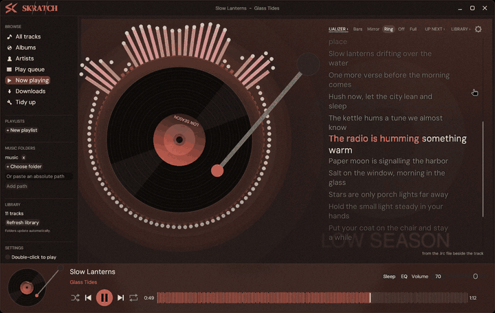

Synced lyrics follow the song, word by word:

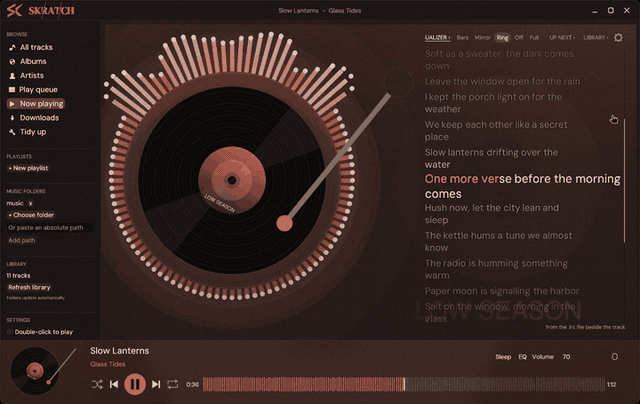

| | |
|---|---|
| 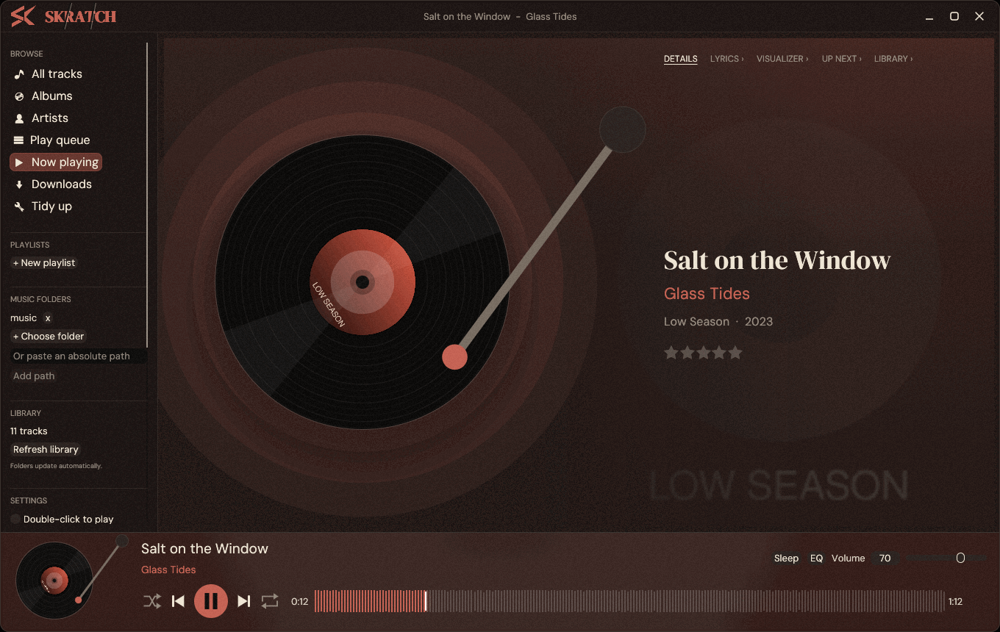 | 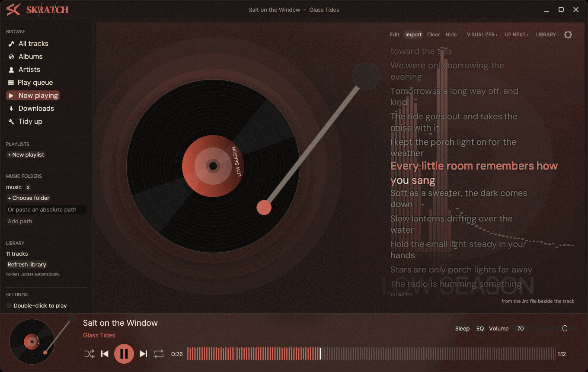 |
| 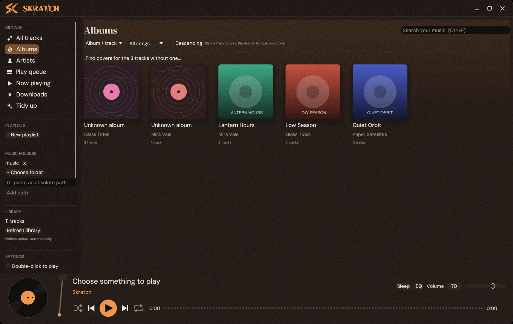 | 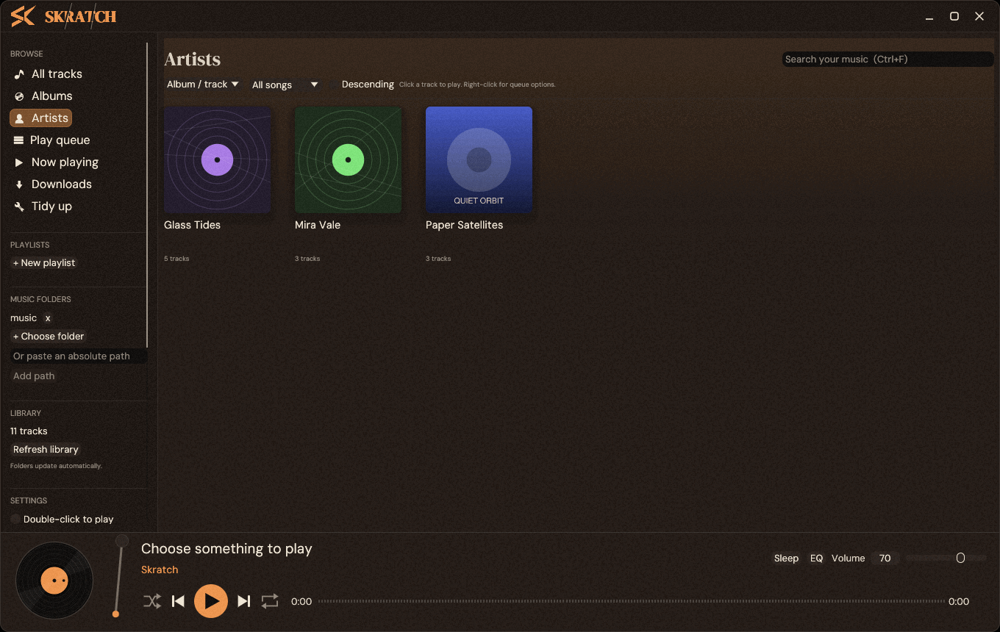 |
| 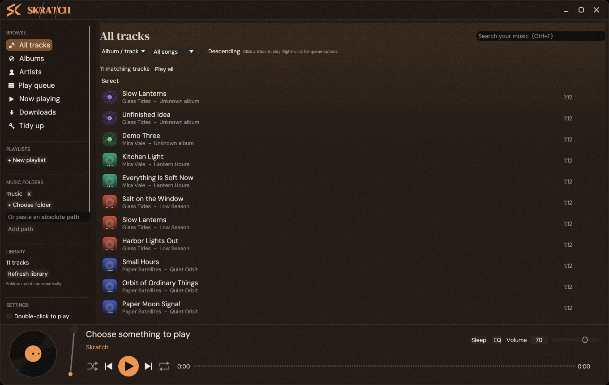 | 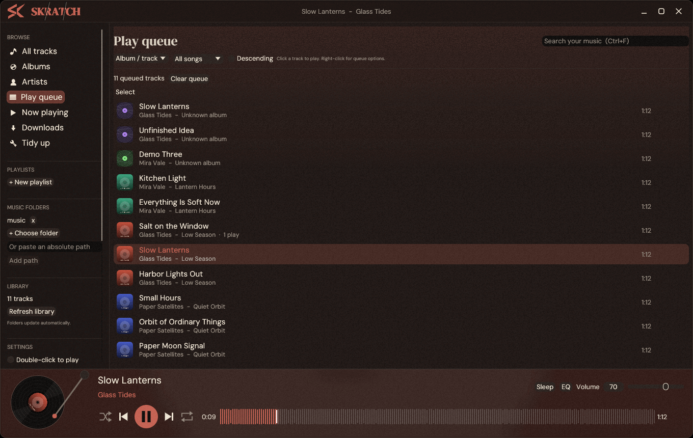 |
| 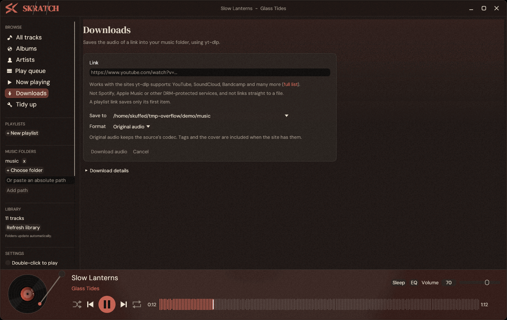 | 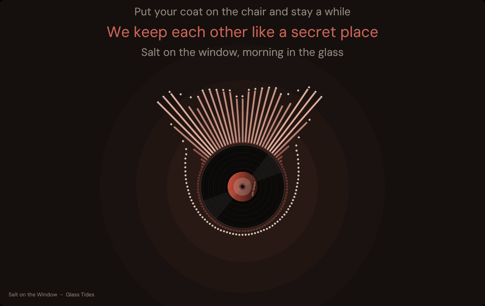 |
| 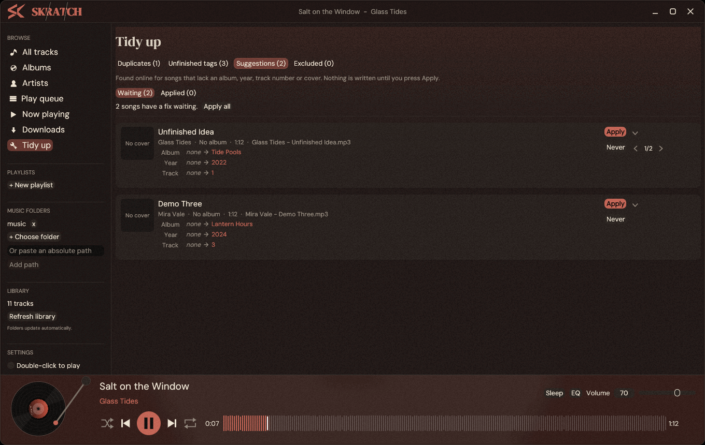 | 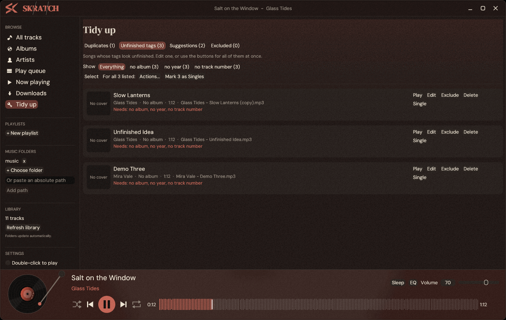 |

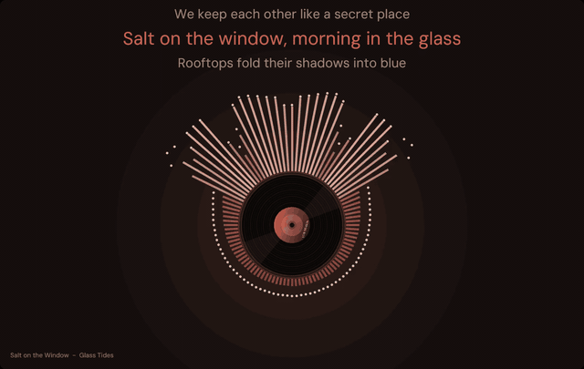

## Features

- **Library:** album, artist and track views. It scans your folders recursively, watches them for changes, and never copies or moves your music.
- **Formats:** MP3, FLAC, WAV, Ogg/Vorbis, Opus, AAC, M4A, MP4, AIFF, WMA, APE and WavPack. What actually plays depends on your mpv.
- **Search:** `Ctrl+F` jumps to the search box. Sort by album, artist, title, year or filename.
- **Tag editing:** edits go into the file itself, using a temp copy and an atomic rename so a failed write can't corrupt a track. Renaming never overwrites an existing file.
- **Batch tagging from filenames:** select several tracks and fill their tags from names like `Artist - Title ft. Someone`. The pattern is configurable (`{artist} {title} {album} {track}`). Featured artists are detected automatically, and downloader clutter such as `(Official Video)` or a trailing `[video id]` is dropped.
- **Cover search:** "Find cover online..." (track menu, album page, edit dialog, or a multi-selection) looks up covers on iTunes, Deezer and MusicBrainz / Cover Art Archive, on TheAudioDB when nothing else has one, and on Genius when "Also look for covers on Genius" is ticked (off by default, because Genius's terms do not allow automated use; its covers are labelled Genius, and for a single or unreleased track with no album it offers the song's own art). It only searches when you ask. By default the cover is kept in Skratch's own cache, survives rescans and never touches your audio files. Tick "Also save into the audio file" to embed it too, so other players show it; the choice is remembered. Double-click a cover to use it. With several albums selected, or "Find covers for the N tracks without one..." on the Albums page, it steps through them one at a time: pick a cover and the next album comes up.
- **Downloads:** paste a link and Skratch runs `yt-dlp` + `ffmpeg` in the background, with progress and cancel. It works with whatever sites [yt-dlp supports](https://github.com/yt-dlp/yt-dlp/blob/master/supportedsites.md) (YouTube, SoundCloud, Bandcamp and many more), not Spotify, Apple Music or other DRM-protected services, and a playlist link saves only its first item.
- **Playback:** queue, shuffle, repeat, seeking, media keys and the desktop now-playing widget (MPRIS). Opening the app never starts audio on its own.
- **Plays and ratings:** a song counts as played once you have heard half of it (or four minutes), and its play count and last-played time are kept in Skratch's own database, not in the file. Give songs one to five stars on the Now playing details or from any track menu (it works on a whole selection). Sort lists by last played, play count or rating, and filter them to songs not played yet, played, or rated.
- **Sleep timer:** the Sleep button in the player bar stops the music in 15 to 90 minutes, or at the end of the song, fading the sound out first.
- **Gapless, fades and loudness:** the next song is lined up ahead of time so albums play without a pause (a setting, on by default). "Fade between songs" dips each song out and the next in over 2 to 10 seconds; it does not overlap two songs. "Even out loudness" uses ReplayGain tags per song or per album, or a compressor that levels songs with no tags.
- **Suggested fixes:** songs missing an album, year, track number or cover are looked up in the background (the one playing first, then the one lined up next, then the rest of the library, one at a time) on MusicBrainz, iTunes and the Cover Art Archive, which are sent the artist, title and length. Only official studio releases by the same artist, with a matching length, are offered. A card above the record on Now playing shows what would change, with a 1/3 counter and arrows when several albums fit. **Apply** writes the tags and the cover into the song's file; the arrow beside it takes just the tags or just the cover. The year is the album's first release year (a reissue's own year is not used). **Skip** puts the card away for this run, **Never** never asks for that song again, and a song with nothing found is not looked up again for a week. What was found is kept between runs. Right after applying, the card offers **Undo** (tags put back, the cover taken out of the file); the last 40 applied fixes can be undone from Tidy up. On by default; two tick boxes in the settings turn it, or only the background checking, off.
- **Tidy up:** a page that lists songs which are in the library twice (same title and artist once filler like "(Official Video)" is ignored, within a few seconds of the same length) and songs whose tags look unfinished (no artist, album, year or track number, filler or numbering in the title). Each song there has **Exclude** (takes it out of Skratch and keeps scans from finding it again; the file stays, and the Excluded tab brings it back) and **Delete** (removes the file from the disk after a Yes/No question beside the button; it cannot be undone). Each group of duplicates also has **Keep only this** and **Delete others** (with a question) on every song. The Suggestions tab lists every fix waiting (apply one, apply all after a question, never) and every applied fix (undo). On Unfinished tags, **Select** ticks songs (Shift-click a tick for a range) so the batch tools work on just those. **Single** on a song, or **Mark N as Singles** for the listed or ticked ones, writes "Singles" as the album of songs that have none (songs with an album are left alone), and a song in Singles no longer needs a track number. The batch tools (fix tags from filenames, fetch metadata, covers) work on whatever is listed or ticked. Every track menu (right-click, the select bar, and the album and artist cards) also has **Remove from library** (the files stay) and **Delete files...** (with a question).
- **Now playing:** click the record in the player bar, or pick "Now playing" in the sidebar, for a big spinning record with the track details, the cover faded in behind them, and a halo that pulses with the bass (mp3, aac/m4a, flac, ogg, wav; Opus is not decoded yet, so those stay still). Click the record to pause or resume. The right-hand side has a row of tabs: track details, lyrics, the visualizer, the queue ("Up next") and the whole library. Lyrics and Visualizer are one page, the visualizer with the lyrics over it; each tab slides its quick options out along the row (Lyrics: look up or try again, type, import, hide; Visualizer: bars, mirror, ring, off, full screen), pushing the tabs after it to the right and cutting them off before the gear. Opening one closes the other, and so does clicking it again or clicking elsewhere. Up next and Library share one "Search" bar, a Select pill that slides out Done, All, None and Actions (the track menu for the selection; Escape also leaves select mode), so you can pick a track without leaving the page, and the bar stays put when you switch between the two. The visualizer keeps running behind both lists on a dark backing that fades out toward the bottom of the list. Switching tabs fades the new view in from the top down, and nothing moves. Hover the cog at the top right and it pulls a drawer out over the panel by a small tab on the drawer's left edge. The drawer has a Visualizer section and a Lyrics section, each with its own toggles, and covers the row of tabs while it is out. It slides back, cog and all, once the pointer has been away for a moment. The left sidebar scrolls when the window is too short to show all of it.
- **Lyrics:** read from a `.lrc` file next to the track or from the file's own tags. Synced lyrics follow the song and a click on a line jumps there. If neither exists, Skratch can look them up on [LRCLIB](https://lrclib.net), a free community database. That is off until you tick "Look up lyrics online", and it sends the artist, title, album and length. A second tick box adds NetEase Cloud Music for tracks LRCLIB doesn't have; it gets the artist and title. Results are cached locally. A third tick box adds Genius as the last resort: it asks genius.com for the song's page and reads the words from it, so you get plain lyrics with no timing, and since Genius's terms do not allow automated use it stays off until you switch it on. Select songs or an album and choose "Find lyrics" to look them all up in the background with a progress bar and a Stop button, and "Save lyrics into files" to write the lyrics Skratch holds into the audio files' own tags (synced ones as LRC text) so other players show them; a tick box saves them automatically for songs you play through and lookups you run, and stays off because it changes your files. A small line under the lyrics says where they came from (your own file, the `.lrc`, the tags, LRCLIB, NetEase or Genius); when it names a website, the line is a link that opens that site (for NetEase and Genius, the song's own page when it was found, else a search for it), and "Try another source" asks the other service when what you got looks wrong. "Wrong" in the Lyrics tab (and "Clear lyrics") remembers online lyrics as wrong for that song, so they are never offered again; "Allow refused lyrics again" in the drawer undoes it. The player bar picks up a soft backdrop from the cover. Easter egg: when the line being sung says "scratch" or "Skratch" (synced lyrics only), the logo scrubs like a record for a moment; a tick box in the lyrics settings turns it off.
- **Artist photos:** a tick box in the settings (off by default) shows Deezer's picture of each artist on the Artists page; it sends the artist's name and keeps the pictures in Skratch's own cache.
- **Messages** at the top of the window dismiss themselves after a few seconds (longer for longer text; hovering holds them).
- **Controls:** `Space` toggles play/pause and the left/right arrow keys scrub by 5 seconds (unless you're typing). Scroll over the volume slider to change it. A single click plays a track; there's a setting to switch to double-click.

## Credits

Skratch looks things up on these services, only when you ask or have switched it on: [MusicBrainz](https://musicbrainz.org) and the [Cover Art Archive](https://coverartarchive.org) (tags, release years, covers), iTunes, [Deezer](https://www.deezer.com) (covers, artist photos) and [TheAudioDB](https://www.theaudiodb.com) (covers), [LRCLIB](https://lrclib.net), NetEase Cloud Music and [Genius](https://genius.com) (lyrics; Genius also for covers). The artwork and words belong to their artists and these services.

## Install

**AppImage (Linux, x86_64):** download `Skratch-<version>-x86_64.AppImage` from the [Releases](https://github.com/iSkuffed/Skratch/releases) page, make it executable (`chmod +x Skratch-*.AppImage`) and run it. It holds only Skratch; the welcome page below sets up the rest. Check the download against `SHA256SUMS` if you like.

**Windows (64-bit, early):** download `Skratch-<version>-windows-x86_64.zip` from the same page, unzip it and run `Skratch.exe`. The exe isn't code-signed yet, so Windows SmartScreen may warn: choose More info, then Run anyway. The Windows build has had less testing than the Linux one; please open an issue if something is off.

Or build from source (Rust toolchain, a C compiler, `pkg-config` and D-Bus headers are required; on Fedora that's `gcc pkgconf-pkg-config dbus-devel`, on Debian/Ubuntu `build-essential pkg-config libdbus-1-dev`):

```sh
git clone https://github.com/iSkuffed/Skratch
cd Skratch
cargo build --release
./target/release/skratch
```

On first launch a welcome page checks what you already have and sets up the rest:

- **Music folder:** pick where your music lives.
- **mpv** (plays the audio): on Windows, "Install mpv" downloads it into Skratch's own folder (checked against the checksum GitHub lists for it). On Linux, if it's missing, "Install mpv" runs your package manager (dnf, apt, pacman or zypper) through the desktop's password prompt, so Skratch never sees your password. The exact command is shown too, if you'd rather run it yourself.
- **Downloads (optional):** one checkbox fetches `yt-dlp` (about 40 MB) and `ffmpeg` (about 70 MB, 220 MB unpacked) from their official releases, checks them against the published checksums and keeps them in Skratch's own folder. Nothing is installed system-wide, and tools already on your system are used as they are.

You can reopen it any time with "Run setup again" in the sidebar.

Releases are built by `.github/workflows/release.yml` when a version tag (`v0.1.0`...) is pushed: it tests, builds the AppImage on Ubuntu 22.04 (so older distributions work) and the Windows zip on Windows, and attaches both with their checksums to a GitHub Release.

## Where things live

The library database, cached artwork, player state and any downloaded tools (`bin/`, `ffmpeg/`) are in `~/.local/share/skratch`. Set `SKRATCH_DATA_DIR=/some/path` to use a separate library, which is handy for testing.

## Development

```sh
cargo fmt --check
cargo clippy --all-targets -- -D warnings
cargo test
# MPRIS tests against an isolated D-Bus session:
dbus-run-session -- cargo test --test playback -- --test-threads=1
```

Tests use mpv's null audio output and generated temporary media, never your music folders.

### Layout rules

Controls that belong to a panel stay in the same place whatever the content is; they only move when the window is resized.

- **Scroll areas:** always `style::scroll()`, never `egui::ScrollArea::vertical()`. egui's default shrinks the area to its widest row, so the scrollbar drifts to follow the longest title. `style::scroll()` fixes the width to the panel. `clippy.toml` bans the plain constructors, so `cargo clippy` fails if one comes back.
- Any other widget that sizes itself to its content (a side bar, a pull tab, a button column) needs a fixed position or width in the same way. Check it with a short row and a very long row.

| File | What it does |
| --- | --- |
| `src/app.rs` | The egui interface |
| `src/app/shell.rs` | Wraps the interface in a lock and runs a thread that does the playback work (track changes, media keys) while no frames are drawn, as in a minimised window |
| `src/style.rs` | Theme, title bar, record, tonearm and seek bar drawing |
| `src/artwork.rs` | Background cover loading, texture cache, accent colour |
| `src/library.rs` | SQLite index, tags, artwork cache, file edits |
| `src/tagparse.rs` | Filename pattern parser for batch tagging |
| `src/online.rs` | Cover search (iTunes, Deezer, MusicBrainz, Cover Art Archive, Genius) and tag lookup |
| `src/suggest.rs` | Suggested tags and covers for a song, and which songs are worth asking about |
| `src/health.rs` | Finds duplicate songs and unfinished tags |
| `src/genius.rs` | Plain lyrics read from genius.com song pages |
| `src/player.rs` | Headless mpv child process and JSON IPC |
| `src/download.rs` | yt-dlp jobs, progress, cancellation |
| `src/tools.rs` | Finds and installs mpv, yt-dlp and ffmpeg (setup page) |
| `src/service.rs` | Background scans and folder watching |
| `src/media.rs`, `src/queue.rs` | MPRIS, playback order |

## License

GPL-3.0-or-later. See [LICENSE](LICENSE). AIMP was an inspiration; no AIMP code, skins or artwork are included.

Made by [iSkuffed](https://github.com/iSkuffed).
